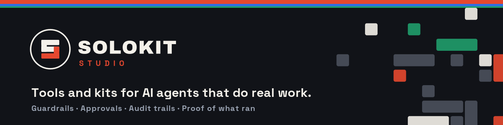

<p align="left">
  
</p>

# Solokit Studio

We build agentic solutions: the guardrails, approvals and audit trails that let an AI agent take real actions without someone re-checking everything it says it did.

Our work is small, practical and inspectable: standard-library Python, plain JSON logs, and docs that state their limits.

## Open source

### [say-do-diff](https://github.com/SolokitStudio/say-do-diff)

Your agent says *"I sent the proposal and refunded the $45."* Your tool log says the email was only queued and the refund timed out. `say-do-diff` finds that gap.

- Compares an agent's final reply with the tool-call log from the same run
- Grades each claim from S0 (no call) to S4 (verified), and flags wording stronger than its evidence
- Catches partial batches ("all 5" when 3 went out), wrong targets, money mismatches and duplicate sends
- Python 3.9+, stdlib only, no network, no model in the loop, MIT licensed

```bash
git clone https://github.com/SolokitStudio/say-do-diff.git && cd say-do-diff
python3 -m saydo_diff --message examples/reply.txt --log examples/tool_log.json
```

## Writing

- [Your agent said it sent the email. Did it? Checking claims against tool receipts](https://dev.to/solokitstudio/your-agent-said-it-sent-the-email-did-it-checking-claims-against-tool-receipts-4o0b) (dev.to)

## Kits

| Kit | What it is | Price |
|---|---|---|
| [Say-Do Gate](https://solokit33.gumroad.com/l/hduxqf) | The in-line version of say-do-diff: HMAC-signed tool receipts, clause-level rewrites of false claims, holds on unconfirmed payments and deletes, and a weekly Say-Do Scoreboard | $49 |
| [Say-Do Diff checklist](https://solokit33.gumroad.com/l/bkgskz) | A 10-minute manual audit of one agent run against its tool log | Free |
| [Operations Suite](https://solokit33.gumroad.com/l/operations-trio) | Cost Governor, Handoff & Memory, Escalation Boundary, Approval Receipt Kit and the Say-Do Gate in one bundle | $149 |

Everything else is in the [Solokit Studio store](https://solokit33.gumroad.com).

## Consulting

We help teams design and review agent workflows: what an agent may do on its own, what needs approval, and how to prove what it did. Reach us on [LinkedIn](https://www.linkedin.com/in/dylan-kerns-solokit).
